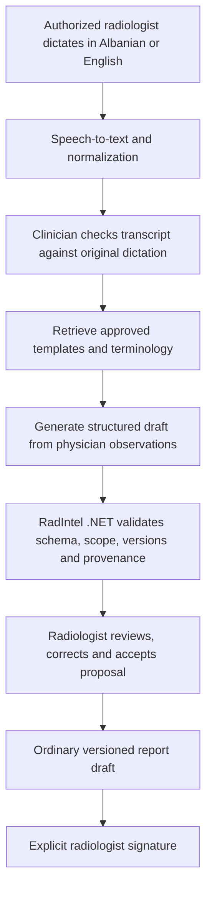

# Problem-solving use cases

> Historical design baseline: this document records the pre-implementation planning snapshot. See [current implementation status](IMPLEMENTATION.md) for delivered behavior, prepared migrations/seeds, validation and remaining integrations.

Version 1.1 | 14 October 2026 | Aligned planning specification

## Purpose and evidence

RadIntel AI targets radiology administration and physician-reviewed reporting: patients, orders, scheduling, worklists, historical reports, PACS study references and operational metrics. The initial scope excludes cardiology, autonomous diagnosis, clinical triage and image-derived AI findings.

The original PDF cites Kosovo digital-health modernization as context. Its national-program claims, local waiting times, vendor penetration and willingness to pay have not been independently validated in this repository review. Confirm them through local research before using them in procurement or sales. Workflow bottlenecks below are hypotheses to test at pilot clinics.

Observed implementation baseline: RadIntel currently contains only an empty solution. Framework provides general backend primitives; AI-Framework provides reusable text RAG primitives. Every product workflow below is planned. A library capability is not a completed use case.

## Use cases and ownership

| ID / release | Problem and proposed workflow | Measure / acceptance evidence | Implementation owner and boundary |
| --- | --- | --- | --- |
| UC-01 / R1 manual, R2 dictation, R3 RAG | Repetitive formatting: open an authorized study, choose an approved template, enter or dictate findings, inspect a proposed draft and sign | Drafting time, clinician edits, signed-report turnaround; no material safety regression | RadIntel Reporting/AI services own schema, input provenance and approval. Shared AI supplies retrieval/model ports only. No template may introduce patient findings. |
| UC-02 / R2 | Historical reports are difficult to locate: verify patient identity, search permitted signed reports and related studies by date/modality | Retrieval task time and correct-patient retrieval rate | RadIntel patient-scoped relational queries; never use a general knowledge index as a patient registry |
| UC-03 / R3 | Longitudinal review is slow: clinician selects two authorized signed versions; system highlights textual differences with version/section references | Unsupported changes, omitted changes and correction rate | Product comparison service; describes report text only, without interpreting pixels or inferring progression |
| UC-04 / R1 | Scheduling lacks visibility: book, move and cancel appointments within scanner capacity; clinical priority comes from authorized staff | No-shows, waiting time, scheduling conflicts and utilization | Product scheduling rules, concurrency and audit; no AI urgency assignment |
| UC-05 / R1 | Assignments are manual: acquired study enters worklist; an authorized radiologist claims, drafts, reviews and signs | Unassigned studies, duplicate claims and reporting turnaround | Product state transitions and atomic assignment; generic CRUD does not protect these invariants |
| UC-06 / R1 links, R2 viewer | Studies live in external PACS: link a verified study and open it through an authorized viewer session | Failed opens, latency, identity matching and access isolation | RadIntel DICOM adapter and viewer authorization; neither framework includes PACS/OHIF |
| UC-07 / R2 | Delivery is ad hoc: distribute only signed reports through an authorized portal or revocable, expiring access | Delivery latency, link expiry/revocation and access audit | RadIntel distribution and notification jobs; no public PACS or report links |
| UC-08 / R1 | Corrections obscure history: freeze the signed version; issue a linked addendum with author, reason and time | Original signature/content preserved; complete correction history | RadIntel report aggregate, signature transaction and immutable version policy |
| UC-09 / R1 basic, R3 advanced | Managers lack workflow measures: aggregate modality volumes, backlog, turnaround, cancellations and downtime | Metrics reconcile with source events; defined reporting window and denominators | Product analytics with minimum necessary patient data |
| UC-10 / R3 | Staff need institutional templates and policies: retrieve approved, versioned documents and return references | Scope leakage, unsupported statements, correct version and source relevance | AI-Framework ingestion/retrieval can be reused; RadIntel owns approval/publication, allowed document IDs and evaluation |
| UC-11 / R3 | Second opinions cross facilities: explicitly authorize a consultation, share selected study/report and record response/sign-off | Consult turnaround, incorrect sharing and revoked-access behavior | Product consultation grants, identity checks and audit; not default cross-tenant search |
| UC-12 / R3 | Downtime disrupts scheduling: record scanner availability/service and suggest nonclinical rescheduling options | Unplanned downtime and rescheduled appointments | Product equipment/capacity rules; no direct control of scanners |

## Intended AI workflow

This is the target shown in the supplied screenshot, with transcript review and proposal acceptance made explicit. Speech recognition and structured report orchestration are new product work. NLP normalization must preserve negation, measurements, laterality and uncertainty; ambiguous content is highlighted for correction. Approved templates supply structure and wording, never new patient observations.

For the screenshot's synthetic chest X-ray example, the supplied observations are: no focal pulmonary consolidation, no pleural effusion, and cardiomediastinal silhouette within normal limits. A draft may arrange those observations under Findings. It must not fill missing technique, comparison, measurements or additional normal findings from template defaults. Any Impression remains a clinician-reviewed restatement of supplied observations. This example specifies behavior; it is not a clinical assessment.

## Illustrative end-to-end journey

A referring clinician requests a chest CT. A scheduler records the patient/order and verifies identifying information. A technician completes acquisition. RadIntel links the PACS study using verified patient/order identifiers and archive identity. The radiologist reviews images in the accepted viewer, prepares a manual report or uses optional drafting assistance, checks the result and signs a specific immutable version. Only that signed content is eligible for distribution. Operational dashboards use auditable event times.

## Prioritization and pilot validation

Score impact, frequency, implementability, procurement feasibility and clinical exposure from 1 to 5 with clinic representatives. Record evidence and uncertainty rather than treating the score as proof of benefit.

| Hypothesis | Original proposed test | Exit decision |
| --- | --- | --- |
| Drafting reduces administrative time | Observe 30-50 sessions with/without assistance | Agreed reduction in time with no material safety regression; evaluate both languages separately |
| Prior reports are slow to locate | Observe 20 authorized retrieval tasks | Improved median retrieval time with correct patient/version and no unauthorized results |
| Worklist improves coordination | Four-week baseline and pilot | Fewer unassigned studies and missing statuses; no duplicate claims |
| Clinics will pay | Interview 10-15 clinics and test paid pilots | At least two paying pilot commitments; recorded integration/support cost |

These are proposed sample sizes and decision gates from the original plan, not completed experiments or validated clinical thresholds.

## Dependencies and unresolved questions

Confirm modalities, RIS/PACS vendors, DICOMweb capability, network topology, scheduling practices, identity systems, and who approves templates/signatures. Select synthetic datasets for engineering and separately authorized datasets for evaluation. Establish the pilot's clinical, privacy, security and intended-use review before real patient use. Preserve manual reporting whenever AI is disabled or unavailable.

For release acceptance and all functional requirements, see [functional documentation](02_Functional_Documentation.md). For concrete shared-library limitations, see [alignment checklist](05_Framework_Alignment.md).

