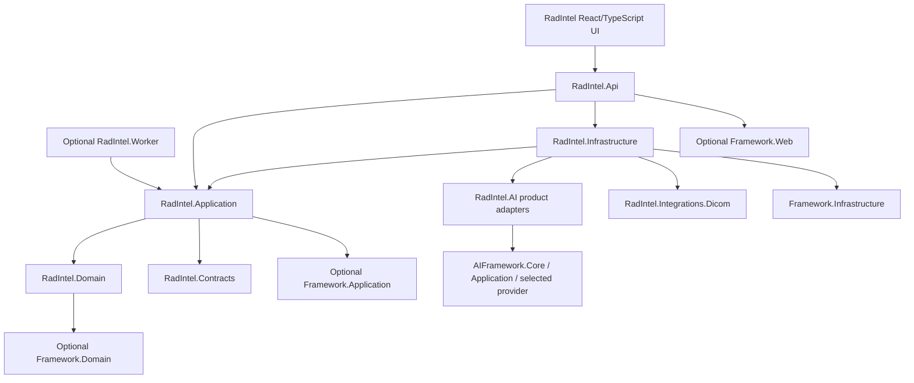
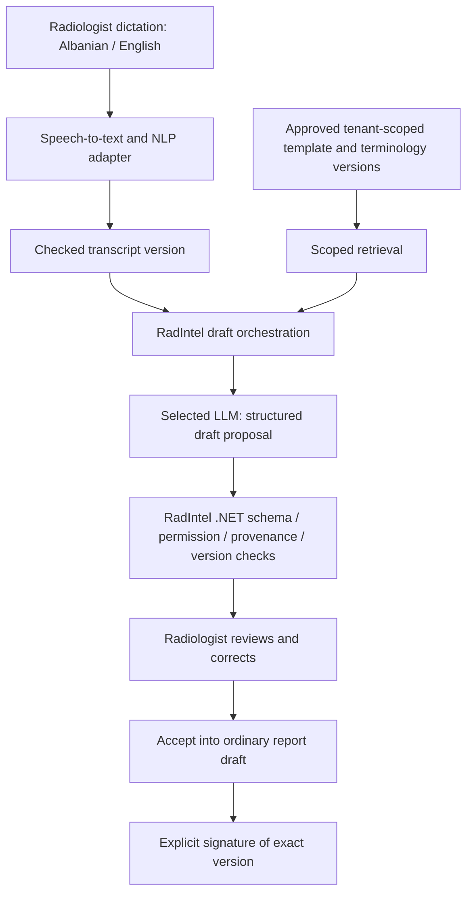

# Technical documentation

> Historical design baseline: this document records the pre-implementation planning snapshot. See [current implementation status](IMPLEMENTATION.md) for delivered behavior, prepared migrations/seeds, validation and remaining integrations.

Version 1.1 | 14 October 2026 | Aligned planning specification

## 1. Observed baseline and decisions

`RadIntel-AI.sln` exists and has no Project entries. No RadIntel application, worker, UI, database, endpoints or deployment is implemented. The structure below is a proposed implementation map, not a description of existing folders.

Retain the original modular-monolith approach. Consume sibling shared libraries directly. Framework remains general-purpose and AI-independent; AI-Framework remains domain-neutral and independent of Framework and RadIntel. RadIntel owns clinical/product behavior and composes optional providers. No new mandatory AI microservice is required.

Shared source currently targets .NET 9. Start compatibility work against the observed target or coordinate a separate upgrade across consumers; this documentation does not change target frameworks, dependencies or existing hosts. The repository name is `AI-Framework`, namespaces are `AIFramework.*`; do not use stale `Framework.Application.AI` or `BuildingBlocks.AI.*` paths.

## 2. Dependency graph and proposed structure



All nodes labelled RadIntel are planned. Application owns ports for transcription, draft generation, approved-template retrieval, PACS and notifications. Infrastructure/product adapters implement those ports. Keep provider packages and HTTP clients out of the radiology domain. Neither shared repository references RadIntel, and no library references either reference host.

```text
RadIntel-AI.sln                         existing, currently empty
src/RadIntel.Domain/                   proposed aggregates/invariants
src/RadIntel.Contracts/                proposed API commands/read DTOs
src/RadIntel.Application/              proposed use cases, ports, authorization
src/RadIntel.Infrastructure/           proposed RadIntelDbContext, migrations, outbox
src/RadIntel.Api/                      proposed composition/auth/API
src/RadIntel.AI/                       proposed product prompts/proposals/adapters
src/RadIntel.Integrations.Dicom/        proposed PACS adapter (R1/R2)
src/RadIntel.Worker/                   defer until durable jobs are needed
src/RadIntel.Integrations.Fhir/         defer until a receiving contract exists
tests/RadIntel.UnitTests/              proposed domain/use-case tests
tests/RadIntel.IntegrationTests/       proposed DB/provider/integration tests
tests/RadIntel.SecurityTests/          proposed permission/abuse tests
web/radintel-web/                      proposed React/TypeScript UI
deploy/docker/                        proposed product containers
deploy/infra/                         proposed product resource composition
```

Preserve the existing solution name. Create only projects needed by the next phase; worker/FHIR/provider splits are not mandatory upfront.

For workspace development, use explicit project references with overridable `FrameworkRoot` and `AIFrameworkRoot` properties resolving to sibling repository roots. If the props file sits at the RadIntel root, defaults can resolve `../Framework` and `../AI-Framework`; do not apply that relative path from a nested project without anchoring it. Do not import sibling Directory.Build/Packages files wholesale. RadIntel owns its build/package policy and must keep shared dependency versions compatible. AI-Framework's six libraries are packable; private feed use is an independent release choice. Do not mix project and package references for the same assembly or assume Framework packages have already been published.

## 3. Shared capability map

| Reuse | Actual capability | RadIntel work still required |
| --- | --- | --- |
| Framework.Domain / Contracts | Entity interfaces/base ID, common result/DTO/pagination types | Organization/patient ownership, concurrency, clinical aggregates and commands |
| Framework.Application | Optional base CRUD service/repository contracts, mapping registration | All permission checks, validation, explicit workflow/signing services |
| Framework.Infrastructure | Extensible EF context, repositories, sorting, provider options, health helper | RadIntel context/model/migrations, tenant filters, transactions, audit, outbox and backups |
| Framework.Web | Abstract read/CRUD controller bases | Authorized concrete routes; prevent generic mutation of signed records |
| AIFramework.Core / Contracts | Knowledge/profile/generation records, interfaces and validated request DTOs | Clinical proposal schema, report provenance and product ports |
| AIFramework.Application | Synchronous text ingestion and evidence-based answer orchestration | Publication/version lifecycle, durable indexing jobs, report-drafting orchestration |
| AIFramework.Local | Process-local retrieval and deterministic extractive answers | Synthetic demo only; no real local LLM, speech, durability or clinical quality guarantee |
| AIFramework.Azure | Azure OpenAI chat/embeddings and Azure AI Search retrieval/indexing | Approved model, identity, index lifecycle, residency and product evaluations |
| AIFramework.Aws | Bedrock Converse chat implementation | Retrieval/embeddings selected separately; no AWS speech or search implementation supplied |

`Framework.Api` and `AIFramework.SampleApi` are reference hosts. Do not reference their assemblies, expose the sample as RadIntel's production AI service, or treat their authentication setup as the product identity system.

## 4. Identity, modules and application persistence

Modules retain original responsibilities: Identity/Tenancy, Patient Registry, Orders/Scheduling, Imaging Integration, Reporting, AI Assistant and Audit/Analytics. Integrate an external OIDC provider; RadIntel owns membership, facility grants, patient/study access and action policies. Enforce authorization in every use case, including worker, export, search, count and import paths.

Implement `RadIntelDbContext : FrameworkDbContext` or a product DbContext consuming selected helpers. Register typed product options and apply RadIntel entity configurations explicitly. The base context applies configurations from the Framework infrastructure assembly only. Do not call `AddInfrastructure(configuration)` unchanged expecting a product database: it registers `FrameworkDbContext`, the base repository and the Framework migrations assembly. Product registrations must use `RadIntelDbContext`, the selected provider and RadIntel's migrations assembly. The three-parameter `BaseRepository<TEntity,TId,TContext>` supports a product context but its default Query is unscoped; override/wrap access before exposing it to product services.

Select PostgreSQL or SQL Server before the first application migration. Both have base-provider support; they do not share interchangeable migrations. Maintain a separate reviewed provider-specific schema if supporting both later. Framework's reference context has no business tables. AI-Framework needs no relational schema and must not gain a clinical database dependency.

### Proposed relational model

| Area | Product tables / essential constraints |
| --- | --- |
| Tenancy | Organizations, Facilities, Memberships, RoleGrants; tenant-scoped relationships and access grants |
| Patients | Patients, PatientIdentifiers, Referrers; identifiers unique within agreed tenant/issuer scope; verified merge history |
| Orders | ImagingOrders, Appointments, WorklistAssignments, Equipment, DowntimeEvents; role transitions, scanner capacity and atomic claim |
| Imaging | Archives, ImagingStudies, SeriesReferences; scoped archive identity plus StudyInstanceUID uniqueness; explicit patient/order mapping |
| Reporting | Reports, ReportVersions, ReportTemplateVersions, Signatures, Addenda; unique report/version, signed version immutable, linked correction |
| AI | DictationTranscriptVersions, AIProposals, AIProposalSources; input/base/template/source version IDs, model/prompt/schema identity, status and reviewer action |
| Distribution | DeliveryGrants, Notifications, OutboxMessages; signed-version reference, expiry/revocation, idempotent delivery |
| Governance | AuditEvents, ConsentOrLegalBasisRecords, ConsultationGrants; restricted append-only access and explicit cross-facility grants |

Use UUID product IDs and explicit OrganizationId on tenant-owned data (or an equivalently enforced relationship); enforce same-tenant foreign-key relationships to prevent cross-tenant linking, not just filtered reads. Scope facility and patient queries further. Add optimistic concurrency tokens and indexes for worklist/status/date, patient timeline and foreign keys. Provider-specific constraints and migrations belong here.

A signed report binds signer identity, exact report version/content digest and signing time. A digest alone is not a cryptographic signature, immutable audit store or legal-signature certification. Define actual signature/step-up/tamper-evidence requirements separately. Signing, freezing content and recording audit/outbox intent share a database transaction. Block update/delete paths for signed versions; corrections create separately signed addenda.

Classify and protect patient names, identifiers, DOB, clinical text, audio, transcripts and backups. Fields labelled encrypted in the original sketch require an actual key-management/encryption design. Do not claim encryption, retention enforcement or audit immutability from schema names alone. Seed synthetic fixtures and approved reference catalogs only; never production patient records or real credentials.

## 5. Target AI flow from the screenshot



Speech-to-text/NLP is a new RadIntel port and approved adapter, not `IDocumentTextExtractor`: that interface is a document-file extraction extension with no working OCR implementation. Language availability and clinical transcription quality must be evaluated for the chosen service. Preserve the original transcript and corrections; normalization cannot discard negation, units, laterality or uncertainty.

Approved templates/policies supply report structure and terminology. Only the authorized encounter's checked physician input supplies current findings. Prior reports may support explicitly labelled historical comparison only when selected and authorized; they are not evidence of current findings. Do not insert normal boilerplate from a template into empty findings.

### Retrieval and publication

Use `DocumentIngestionService` for curated text ingestion and `IKnowledgeRetriever` for allowed evidence selection. `KnowledgeAnswerService` fits UC-10 institutional Q&A; its Question limit is 2,000 characters and it returns text/citations, not a clinical report schema. It must not become a hidden transport for long clinical transcripts or a claimed structured-output validator.

The default catalog contains only `general-document` with ingest/question-answering operations. Proposed `radiology-template` / `radiology-policy` profiles and their `sq`/`en` language policy must be implemented in a RadIntel `IDocumentProfileCatalog`. `RequiresHumanReview` is descriptive; product services enforce review. SupportedLanguages metadata alone does not evaluate language quality or enforce a complete language policy.

Resolve OrganizationId and allowed documents from authenticated membership and the requested clinical resource. Supply an explicit published-version allowlist. AI-Framework accepts chunks with null ScopeId as tenant-wide evidence, even for a scoped request. Therefore ScopeId alone is insufficient for facility/document ACLs. Use a product retriever/filter plus explicit DocumentIds and independently recheck returned provenance. An empty authorized set must fail closed, never be converted to null (unrestricted within the supplied tenant/profile). Library tenant IDs are caller-provided boundaries, not proof of membership.

Keep patient reports/audio/transcripts outside the general template/policy index. RadIntel owns document approval, stable product version IDs -> index document IDs, publication, revocation, deletion and reindex jobs. Default ingestion assigns a new ID on every call and supplies no durable idempotency or delete/replace workflow. Remove stale versions from the allowed set immediately, even if physical index cleanup is delayed. AI-Framework ingestion is synchronous text processing with a one-million-character limit; it is not a file-upload queue or document-management system.

### Structured proposal and validation

Implement a product draft-generation service through a RadIntel port using the selected model abstraction or a product-specific structured-output adapter. `IChatModel` currently accepts `GroundedGenerationRequest` and returns an answer/provider string. Provider-independent schema-constrained output is not implemented. A prompt asking for JSON does not establish a schema guarantee; parse and reject invalid output in .NET, or add a separately reviewed adapter capability.

Proposed proposal payload contains schema version, language, examination metadata references, findings sections, clinician-reviewed impression, incomplete/ambiguous fields and source references. Persist outside the model response: organization/patient/order/report IDs, base report version, checked transcript version, template version, retrieved document/chunk versions, prompt/schema/model/deployment identity, request/time, validation result and reviewer action. Do not trust model-supplied scope or provenance IDs without comparing them to server-authorized inputs.

Validation must reject malformed/oversized JSON, unknown fields where disallowed, unsupported language, invalid resource links, stale base versions, required-field omissions and references outside the authorized evidence set. Apply deterministic consistency checks for numbers/units/negation when feasible, and highlight uncertainty. These checks cannot establish the clinical support of every generated sentence; radiologist review remains mandatory.

Display original/checked input, proposal diff, warnings and source versions. Acceptance creates a draft; it cannot sign, deliver, modify signed content or set clinical urgency. Pin provenance to the actual provider/model deployment and configuration used; the shared generation result's provider string alone does not contain full model/prompt/version history. Preserve manual reporting when transcription/retrieval/generation fails, is disabled or exceeds quota. Planned timeouts, budgets, circuit breakers and retries require product implementation.

`Grounded=true` means retrieved context was supplied, not independently verified assertions. Citations enumerate retrieved chunks, not proof every sentence used them. Neither flag establishes clinical correctness.

## 6. Provider registration and configuration

These are existing library registrations shown for future composition, not runnable RadIntel startup code:

```csharp
// Synthetic text retrieval / Q&A demo only:
services.AddAiApplication();
services.AddLocalAi();
```

```csharp
// Alternative approved Azure text pipeline:
services.AddAiApplication();
services.AddAzureAi(configuration);
```

The extension namespaces are `AIFramework.Application`, `AIFramework.Local` and `AIFramework.Azure`. Register a product profile catalog before defaults (TryAdd) or explicitly replace it afterwards. Compose exactly one intended chat model, index and retriever. Azure models/search can be registered separately with `AddAzureModels` and `AddAzureSearch`; `AddBedrockChat` provides independently selectable chat. Last `IChatModel` registration wins, so provider choice must be explicit and tested. An approved private/offline model needs a new adapter; Local is not that implementation.

| Existing configuration / input | Owner / use |
| --- | --- |
| `ConnectionStrings__DefaultConnection`, `Database__Provider` | Product may retain these base conventions, but must wire its own context/migrations |
| `Authentication__Authority`, `Authentication__Audience` | Product JWT configuration; membership/patient authorization is additional |
| `AI__Azure__OpenAiEndpoint`, `AI__Azure__ChatDeployment`, `AI__Azure__EmbeddingDeployment` | Azure model registration; HTTPS endpoints and managed/workload credential strategy |
| `AI__Azure__SearchEndpoint`, `AI__Azure__SearchIndex` | Azure search registration; index dimension/model compatibility and scoped evidence |
| Bedrock region and explicit permitted model/inference-profile ID | `BedrockOptions` in product composition; AWS credential chain/workload role |
| Product AI-off flag, quotas, speech config, approved corpus and schema version | Proposed RadIntel settings; names/contracts to define during implementation |

Azure uses DefaultAzureCredential unless the host supplies TokenCredential; transport timeout is currently 60 seconds. This is not a complete resilience policy. AWS supplies chat only; retrieval and embeddings must be selected independently. Do not copy sample anonymous-access flags into a clinical host. No live provider access or RadIntel provider suitability was validated in this revision.

## 7. Proposed HTTP contracts

All routes below remain unimplemented. Use product authorization before invoking shared services.

| Route | Action / policy |
| --- | --- |
| `POST /api/v1/patients` | Authorized scheduler/admin registers a patient within tenant/facility scope |
| `POST /api/v1/imaging-orders` | Authorized staff creates a patient-linked order |
| `GET /api/v1/worklist` | Permitted technician/radiologist worklist with scoped pagination |
| `POST /api/v1/reports/{id}/drafts` | Radiologist saves a version with concurrency protection |
| `POST /api/v1/reports/{id}/ai-draft` | Feature-enabled radiologist requests an unapproved proposal; never finalizes |
| `POST /api/v1/reports/{id}/sign` | Authorized qualified radiologist signs exact current version with step-up policy |
| `POST /api/v1/reports/{id}/addenda` | Authorized radiologist creates a separately reviewed correction |
| `GET /api/v1/studies/{id}/viewer-session` | Authorizes study-specific short-lived viewer context; no public cache |

Use Problem Details for errors, bounded pagination, OpenAPI, redacted correlation IDs, rate limits and concurrency tokens/ETags. Decide idempotency-key storage and replay behavior for effectful writes. Generic controllers are appropriate only where scoped service implementations preserve invariants; signing, approval and correction use explicit commands.

## 8. DICOM/PACS, viewer and later FHIR

Retain existing PACS as image owner. RadIntel stores study/archive references and workflow metadata. Target DICOMweb QIDO-RS search, WADO-RS retrieval and explicitly permitted STOW-RS storage only where the archive supports them. Discover vendor conformance and legacy gateway needs instead of assuming support. OHIF documents separate DICOMweb data-source roots; configure and test against the selected archive: [OHIF DICOMweb documentation](https://docs.ohif.org/configuration/datasources/dicom-web/).

Authorize image/metadata/thumbnail requests as well as viewer launch. Restrict archive endpoints to trusted configuration to avoid arbitrary URL/credential forwarding. Do not put unrestricted PACS credentials in browser configuration. Short-lived viewer context must constrain the underlying data path, not merely hide navigation. Validate identity using issuer/patient/order/archive identifiers; never patient name alone. Viewer diagnostic acceptance is an explicit clinic responsibility, not established by embedding OHIF.

Later FHIR mappings can include Patient, ServiceRequest, ImagingStudy, DiagnosticReport and Observation after agreeing version/profile with the receiving system. DiagnosticReport represents report results and associated observations in the standard: [HL7 DiagnosticReport](https://hl7.org/fhir/diagnosticreport.html). This is a future adapter design; it does not establish IHIS connectivity or national conformance. Pin an agreed version; do not build against an assumed national API.

## 9. Infrastructure and operations ownership

| Layer | Existing material | Product composition / missing work |
| --- | --- | --- |
| General hosting/database | Framework infrastructure Bicep/Terraform examples for Azure container hosting, identity and SQL | Product image, auth/networking/secrets, DB choice, migrations, clinical access and backups |
| AI | AI-Framework Azure OpenAI/Search modules and bootstrap; optional AWS Bedrock IAM policy | Approved configuration, runtime identity, index lifecycle, budgets, residency and evaluations |
| RadIntel | No infrastructure exists | Compose selected modules with distinct product resource ownership; PACS/OHIF, jobs and operational runbooks |

Choose one IaC owner per resource set. Do not apply split Framework templates over an existing environment before reviewed AI resource state/ownership migration. Source paths do not transfer Terraform/Bicep ownership. The reference access.bicep assumes an existing `${prefix}-api-identity`; verify product identity/prefix or adapt module inputs in a separate change. No cloud resource, deployment, state or identity is modified here.

Framework's sample hosting uses Azure SQL; a PostgreSQL product cannot use that database example unchanged. Base AWS hosting, production private networking, and on-prem packaging are not supplied. AI-Framework's reference search index uses 1536 dimensions; choose a matching embedding model or explicitly migrate schema/reindex. Do not change an existing index/model implicitly.

RadIntel must implement durable jobs/outbox, retries/dead-letter handling, idempotent notification, usage/cost limits, monitoring and incident procedures. Persist intent before external effects. Emit patient-free structured metadata/metrics and protected audit records; no routine raw prompt/audio/report logging. Define readiness independently from liveness and optional AI health so manual reporting can continue during AI outages. Agree encrypted backup schedules, restoration tests and actual pilot RPO/RTO before operations.

## 10. Verification and phased engineering

No application behavior can be tested until projects exist. This revision validates documentation references and the empty solution baseline only; shared code and cloud services were not modified or revalidated by new runtime tests.

1. Discovery: clinical owner, data classification, threat model, database/identity/PACS decisions and synthetic corpus.
2. Foundation: minimal product projects, library references, product context/migration, JWT/membership/resource authorization and scoped queries.
3. Operations: patient/order/scheduling/worklist state machines and concurrency, basic protected audit.
4. Reporting: approved template versions, manual drafts, immutable signing/addenda, transactional outbox and export policy. Complete R1 acceptance.
5. Imaging/input: sandbox PACS, authorized DICOMweb/OHIF flow, bilingual UI/templates, checked dictation, prior-report search and secure delivery. Complete R2 acceptance.
6. Optional AI: approved corpus publication/allowlists, proposal schema/validation, model provenance, review/diff UI, quotas/fallback, textual comparison and R3 evaluations.
7. Readiness: restoration, security/clinical UAT, provider contracts, observed performance, training and pilot runbook before each real deployment.

Required tests: domain transitions and stale versions; concurrent booking/claim/sign; actual database constraints/migrations and tenant relationship integrity; revoked/scoped patient access including worker/export/PACS; outbox duplicate/failure recovery; signed-content immutability and addenda; invalid/malicious/unsupported AI output, missing evidence and cross-scope citations; Albanian/English negation/laterality/number accuracy; approved template revocation; viewer request isolation; provider outage/manual fallback; recovery/load under defined pilot conditions.

Clinical/operational acceptance is separate from deterministic library tests. Future image AI remains a separate intended-use, evidence and governance workstream.

## 11. Source authority

Repository evidence and original-to-revised mapping are recorded in [the alignment checklist](05_Framework_Alignment.md). The four unmodified source PDFs remain under [originals](originals/README.md). Their external market/legal references were not revalidated here. The two linked official integration sources above support the limited DICOMweb/FHIR descriptions; they do not validate a RadIntel implementation.

